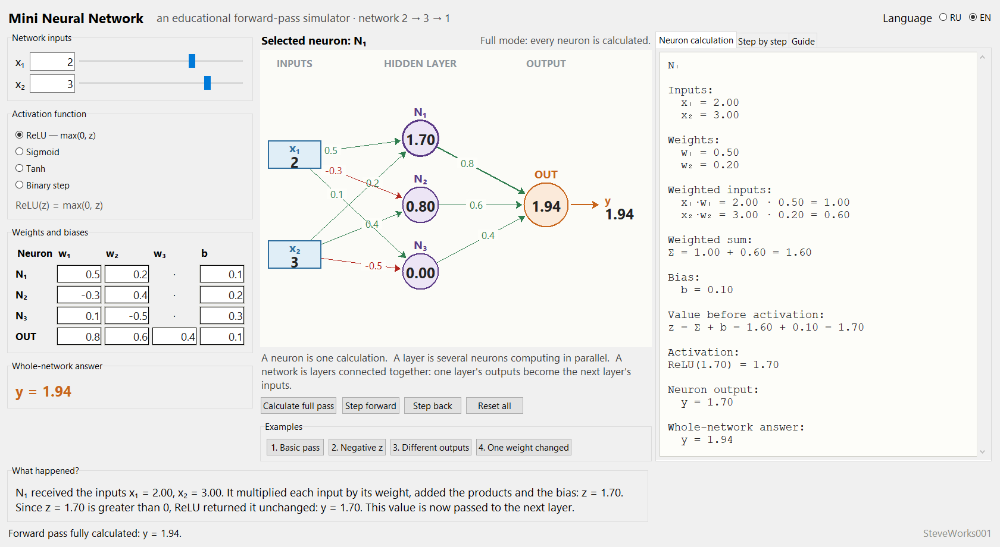
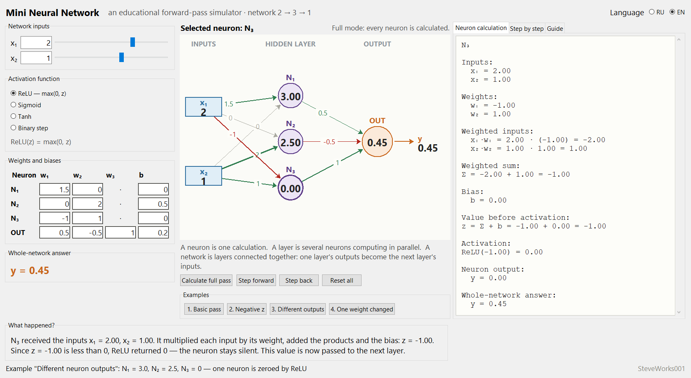
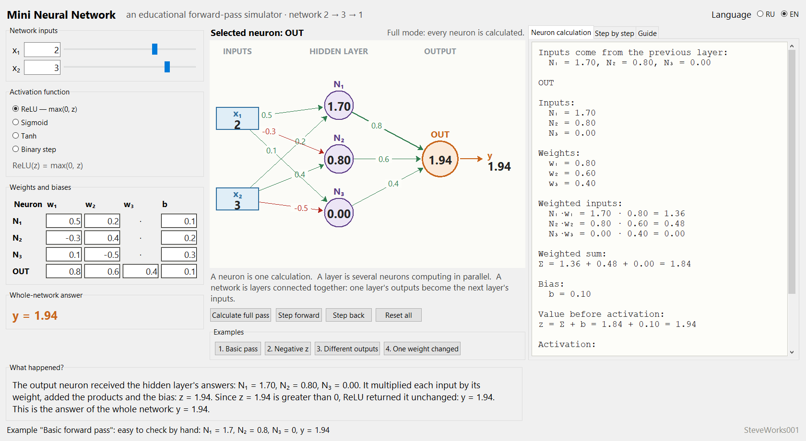
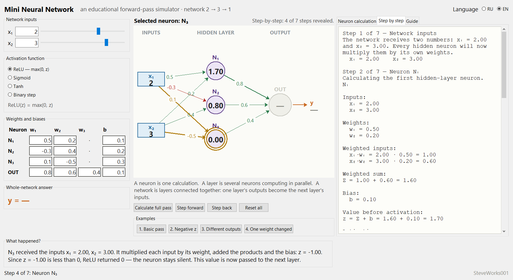

# Mini Neural Network — An Educational Simulator

**[English](README_EN.md) | [Русский](README_RU.md)**

Project 3 of 13 in the educational neural-network simulator series.
A single-file Python and Tkinter application: standard library only, no external packages,
no network and no dependency installation.
This is a **2 → 3 → 1 network where every number at every step is visible**: the program
shows one pass of data through a simple neural network — the *forward pass*. You set every
weight, and nothing is ever trained. The point is to see how individual neurons form a
layer, and how layers form a network.

---

## Purpose

This is the step after the "One Artificial Neuron" and "Perceptron" projects: there was one
neuron, here there are four, wired into two layers. The program shows three things that a
single neuron cannot reveal:

- a neuron computes one number, while a layer computes several numbers in parallel;
- the outputs of one layer literally become the inputs of the next;
- changing a single weight anywhere changes the answer of the whole network, and you can see
  at which neuron the change starts.

### What this project does not contain

- no training, no backpropagation, no gradient descent;
- no loss function, no data sets, epochs, metrics or predictions over data;
- no automatic weight search — only values you type and ready-made examples;
- no arbitrary architecture: the network is always `2 → 3 → 1`;
- no project saving, files, database or network access.

The application **does not train a neural network**. It explains what happens during one
forward pass when the weights are already known.

---

## Learning goals

- Understand that each neuron computes one number: `z = Σ(xᵢ·wᵢ) + b`, then `y = f(z)`.
- Understand that a layer is several neurons computing in parallel, unaware of each other.
- Understand the hand-over between layers: the three hidden values become the three inputs of
  the output neuron.
- Remember that the bias `b` is always added, even when every input is zero.
- Understand that a "silent" ReLU neuron does not disappear: it still takes part in the next
  layer's calculation, contributing `0`.
- See how one changed weight moves the answer of the whole network, and locate where it starts.
- Learn to tell a neuron's `z` apart from its output `y` across all seven steps of the pass.

---

## Mathematics and architecture

```text
2 inputs      3 neurons       1 neuron
x₁ ──┐     ┌──► N₁ ──┐
     ├─────┼──► N₂ ──┼──► OUT ──► y
x₂ ──┘     └──► N₃ ──┘
```

Connections are full: every input reaches every hidden neuron (2 × 3 = 6 weights), every
hidden neuron reaches the output neuron (3 weights), plus four biases. Altogether
**9 weights + 4 biases + 2 inputs = 15 numbers**, all of them editable.

How one neuron calculates:

```text
z = x₁·w₁ + x₂·w₂ + ... + xₙ·wₙ + b
y = activation(z)
```

For the selected neuron the program prints the whole chain of substitutions, not just the
result:

```text
N₁

Inputs:
  x₁ = 2.00
  x₂ = 3.00

Weights:
  w₁ = 0.50
  w₂ = 0.20

Weighted inputs:
  x₁·w₁ = 2.00 · 0.50 = 1.00
  x₂·w₂ = 3.00 · 0.20 = 0.60

Weighted sum:
Σ = 1.00 + 0.60 = 1.60

Bias:
  b = 0.10

Value before activation:
z = Σ + b = 1.60 + 0.10 = 1.70

Activation:
ReLU(1.70) = 1.70

Neuron output:
  y = 1.70
```

Every formula prints numbers with two decimal places, like a worked example on a blackboard.

### Activation functions

Switched in the left panel; the formula is shown under the switch.

| Name | Formula | Range of the answer |
|---|---|---|
| ReLU (default) | `ReLU(z) = max(0, z)` | 0 to +∞ |
| Sigmoid | `σ(z) = 1 / (1 + e⁻ᶻ)` | 0 to 1 |
| Tanh | `tanh(z)` | −1 to 1 |
| Binary step | `step(z) = 1 when z ≥ 0, otherwise 0` | 0 or 1 |

ReLU is the default because it is the easiest to draw and to check by hand. There is
deliberately no catalogue of activation functions: the arithmetic matters more than the list.

### The whole forward pass (default values)

Hidden layer:

```text
N₁: z = 2·0.5 + 3·0.2 + 0.1 = 1.70     → ReLU(1.70) = 1.70
N₂: z = 2·(-0.3) + 3·0.4 + 0.2 = 0.80  → ReLU(0.80) = 0.80
N₃: z = 2·0.1 + 3·(-0.5) + 0.3 = -1.00 → ReLU(-1.00) = 0.00
```

Hand-over: the outputs of `N₁`, `N₂`, `N₃` become the inputs of `OUT`.

Output neuron:

```text
OUT: z = 1.7·0.8 + 0.8·0.6 + 0·0.4 + 0.1
       = 1.36 + 0.48 + 0.00 + 0.10 = 1.94
ReLU(1.94) = 1.94

y = 1.94
```

Note `N₃`: its answer `0` does not disappear — it is multiplied by `w₃ = 0.4` and contributes
`0.00` to the output neuron's sum. That is exactly how it works.

### The seven steps of the pass

| Step | Title | What you see |
| --- | --- | --- |
| 1 | Network inputs | `x₁` and `x₂` |
| 2 | Neuron N₁ | the full calculation of N₁ |
| 3 | Neuron N₂ | the full calculation of N₂ |
| 4 | Neuron N₃ | the full calculation of N₃ |
| 5 | Handing over to the next layer | the outputs of N₁, N₂, N₃ become OUT's inputs |
| 6 | Output neuron | the full calculation of OUT |
| 7 | Result | `y` |

---

## Interface and usage

- **Left panel** — the inputs (a text field plus a slider covering −5…5), the activation
  switch with its formula, a weight table of 4 rows (`N₁`, `N₂`, `N₃`, `OUT`) by 4 columns
  (`w₁`, `w₂`, `w₃`, `b`), and the answer of the whole network in large type. For the hidden
  neurons the `w₃` cell holds a dash `·`: no third input reaches them, so there is no
  field to edit.
- **Network diagram (centre)** — the inputs are blue rectangles, the hidden neurons purple
  circles, the output neuron an orange circle, and inside each neuron is its own output. The
  numbers on the lines are weights: green positive, red negative, grey zero, and the thicker
  the line, the larger the absolute weight. Clicking a neuron opens its calculation.
- **Right tabs** — "Neuron calculation" (the full arithmetic of the selected neuron), "Step by
  step" (a cumulative log from step 1 up to the step you reached), "Guide" (ten sections of
  theory).
- **"What happened?"** — four short plain-language sentences about the current neuron: what it
  received, what it did, why the answer looks like this, and what happens next.
- **Buttons** — "Calculate full pass", "Step forward" and "Step back" (one step per press),
  "Reset all" to return to the default values, and four example buttons.
- **Step-by-step mode**: until a neuron's turn comes, its value on the diagram is a dash, and
  the calculation tab says how many more times to press "Step forward". If you change any
  number in the middle of the walk-through, the network recalculates fully.
- **Recalculation is live**: changing any number immediately updates the diagram, every answer
  and the explanations. An invalid entry behaves differently in the two places: a weight-table
  cell is highlighted and the app names the field at fault, while the `x₁` and `x₂` input
  fields silently ignore non-numeric text until the field becomes a number again. Either way
  the calculation keeps the last valid values. A comma works as a decimal separator (`0,5`).

The interface is available in Russian and English and switches on the fly without a restart;
Russian is the default. Mathematical notation (`x₁`, `w₁`, `Σ`, `z`, `y`, `N₁`, `OUT`) and the
numbers you entered stay in place when the language changes.

---

## Screenshots

The pictures below were taken from the running application (1680 × 920 pixel window,
English interface).

**Main window** — the default values, the full forward pass, the "Neuron calculation" tab
showing `N₁`, network answer `y = 1.94`:



**Example 3 "Different outputs"** — the three hidden neurons give 3.00, 2.50 and 0.00;
`N₃` is selected, and ReLU has zeroed its negative `z`:



**Output neuron calculation** — the "Inputs come from the previous layer" line shows that
the three hidden answers became the inputs of `OUT`:



**Step-by-step mode, step 4 of 7** — the amber highlight marks the neuron being calculated
right now, `OUT` and `y` are still dashes, and the tab holds the cumulative log of the steps
reached:



---

## Examples

Each example loads both the numbers and the activation function; its explanation appears in the
status bar and in "What happened?".

### Example 1 — Basic forward pass

```text
x₁ = 2, x₂ = 3, ReLU
N₁: z = 1.70 → y = 1.70
N₂: z = 0.80 → y = 0.80
N₃: z = -1.00 → y = 0.00
OUT: z = 1.94 → y = 1.94
```

Every product is a round number, so the whole pass is checkable by hand in a minute.

### Example 2 — Negative z with ReLU

```text
x₁ = 1, x₂ = 2, ReLU
N₁: z = -2·1 + (-1)·2 + 0.5 = -3.50 → y = 0.00
N₂: z =  1·1 + (-1)·2 + 0.2 = -0.80 → y = 0.00
N₃: z =  2·1 + (-1)·2 - 0.1 = -0.10 → y = 0.00
OUT: z = 0·1 + 0·1 + 0·1 + 0.3 = 0.30 → y = 0.30
```

All three neurons stay silent, yet the network still answers: the output neuron receives nothing
but its own bias. The lesson — `b` is not a spare input, it is always added. Switch this example
to sigmoid and the hidden layer stops returning zeros: `σ(-3.50) ≈ 0.03`, `σ(-0.80) ≈ 0.31`,
`σ(-0.10) ≈ 0.48`, and the network's answer becomes `y ≈ 0.75`.

### Example 3 — Different neuron outputs

```text
x₁ = 2, x₂ = 1, ReLU
N₁: z = 1.5·2 + 0·1 + 0  = 3.00  → y = 3.00
N₂: z = 0·2 + 2·1 + 0.5  = 2.50  → y = 2.50
N₃: z = -1·2 + 1·1 + 0   = -1.00 → y = 0.00
OUT: z = 0.5·3 + (-0.5)·2.5 + 1·0 + 0.2 = 0.45 → y = 0.45
```

Three neurons of one layer produce three different numbers — a layer is parallel computation,
not one shared result. In `N₃` the weight on `x₁` dominates, so the sum goes negative and ReLU
zeroes the answer.

### Example 4 — Effect of changing a weight

```text
The same numbers as in example 1, but OUT: w₁ = 0.8 → 0.2
N₁ = 1.70, N₂ = 0.80, N₃ = 0.00   (the hidden layer is untouched)
OUT: z = 1.7·0.2 + 0.8·0.6 + 0·0.4 + 0.1 = 0.92 → y = 0.92
```

The network's answer moves from `1.94` to `0.92` because of a single weight. The hidden layer
keeps producing exactly the same values — it cannot see the layer after it.

---

## Guided experiments

The experiments below use the default numbers (`x₁ = 2`, `x₂ = 3`, ReLU, hidden layer
`1.70`, `0.80`, `0`, network answer `1.94`), so the arithmetic in them matches what appears
on screen. Work the numbers out yourself first, then check them in the application.

**1. One hidden weight.** Change `w₁` of neuron `N₁` from `0.5` to `2`.
Observe: on the "Neuron calculation" tab `z` of `N₁` becomes `4.7`, and the network answer
becomes `4.34` — the whole network moved, not just one neuron. Click `OUT` and find where
the new summand in its total comes from. Think about: why the network's answer moved more
than the single neuron's answer, and by what factor.

**2. A negative weight goes quiet.** Lower `w₂` of `N₁` from `0.2` to `-0.8`, so that
`z = 2·0.5 + 3·(-0.8) + 0.1 = -1.3`.
Observe: with ReLU the answer of `N₁` becomes exactly `0`, yet the network still outputs a
number — the `N₁` term simply disappears from the sum at `OUT`, leaving `N₂` and the bias.
Now switch the activation to Sigmoid without touching any number and see that `N₁` stops
being zero. Think about: how a "dead" ReLU zero differs from a "small but positive"
sigmoid output as far as the next layer is concerned.

**3. The whole hidden layer silenced.** Load example 2 from the example buttons.
Observe: `N₁`, `N₂` and `N₃` all output `0`, and the network still answers `0.3` — that is
the output neuron's bias. Walk forward with "Step forward" and note where the zeroes stop
looking like a computed result and start looking like "nothing to compute".
Think about: if every neuron of the previous layer is silent, what part of the network can
still say anything — and whether that is enough for a real prediction.

**4. A layer versus a single neuron.** With the default numbers, click `N₃`: its `z` is
`-1.0` and its answer is `0`.
Observe: the contribution of `N₃` reaches `OUT` through `w₃ = 0.4`, so a zero answer simply
adds `0 · 0.4`. Compare this with example 2, where all three are zero.
Think about: what a second and third neuron in the same layer buy you, and how the same
mechanism explains the idea of dead ReLU units.

---

## Installation and launch

The application is a single file; no build step and no dependency installation are required.

```bash
python mini_neural_network.py
```

On macOS and Linux, if needed: `python3 mini_neural_network.py`.

Quick start: press **"Calculate full pass"** — with the default values the network gives
`N₁ = 1.70`, `N₂ = 0.80`, `N₃ = 0.00` and `y = 1.94`. Then press **"Step forward"** seven times
to walk through the whole calculation in order, and click any neuron in the diagram to see its
arithmetic in full.

---

## Requirements

- Python 3.8 or newer.
- Tkinter — included in the official Python builds for Windows and macOS; on some Linux
  distributions it is installed separately as the `python3-tk` package.
- Standard library only: `math`, `textwrap`, `tkinter`, `tkinter.ttk`, `tkinter.font`.
- Not used: NumPy, pandas, SciPy, matplotlib, PyTorch, TensorFlow and anything else from
  `pip`.
- No network connection is required to run the application.

The window is built around three panels standing side by side, so its minimum size is
1640 × 880 pixels; on a narrower or shorter screen it does not fit whole. At startup it
takes 1680 × 920 pixels, or as much of that as the display allows.

---

## Limitations

- This is **not** a machine-learning framework and **not** a prediction tool.
- No training, no backpropagation, no gradient descent.
- No loss function, data sets, epochs or metrics.
- The architecture is fixed at `2 → 3 → 1`; adding a layer or changing the number of neurons
  requires editing the code.
- There are four activation functions, and the chosen one applies to every neuron of the
  network at once — a per-neuron choice is not offered.
- The hidden layer cannot see the layer after it, so the "surprise" when an output weight
  changes is a property of the model, not a display bug.
- No saving or loading: state is not written to files and not exported.
- GUI only: there is no console mode, API or batch run.
- Two interface languages: Russian and English.

---

## Educational note

The simulator exists to make the forward pass understandable, not to produce predictions.
Some conventions are chosen for clarity and may differ from the conventions used by a
particular machine-learning library: for instance, the binary step here assigns `z = 0` to the
answer `1`, and formulas print numbers with two decimal places. Before using a network in
practice, check the definitions in your library.

---

## What to know beforehand

**Hard requirements:** Python 3 with Tkinter, and running one file from a command line.
There are no dependencies, no network use and no external files.

**Mathematics:** multiplying and adding numbers, negatives included, and reading indexed
notation (`w₁`, `N₂`, `Σ`). Derivatives and gradients are not needed — there is no backward
pass here.

**Useful but not required:** project 1, "One Artificial Neuron" — the same computation
`z = Σ + b`, `y = f(z)` for a single neuron. Without it everything is re-explained, only a
little longer.

About the Python version: the Requirements section names Python 3.8 or newer. That is
declared compatibility, not a tested guarantee — the application does not check the version.
The release copy was run on CPython 3.12.10 under Windows 10; versions below 3.8 have not
been tested.

---

## Place in the series

Project 3 of 13. The order is not strict; every project stands on its own.

| Project | Connection by subject |
|---|---|
| 1 — One Artificial Neuron | one neuron taken apart; here the same computation happens
four times in two layers |
| 2 — Perceptron | a neuron as a threshold classifier; this project outputs a number, not a
class |
| 7 — Activation Functions | explains why swapping ReLU for Sigmoid changes everything you
saw in the experiments above |
| 5, 6 — Backpropagation, Neural Network Training | there the weights are found
automatically; here you set every number yourself, and training is absent on purpose |

The forward pass built here is exactly the computation that projects 5 and 6 run backwards
to obtain gradients.

---

## Developer

**Developer: SteveWorks001**

---

## License

This project is distributed under the [MIT License](LICENSE).
