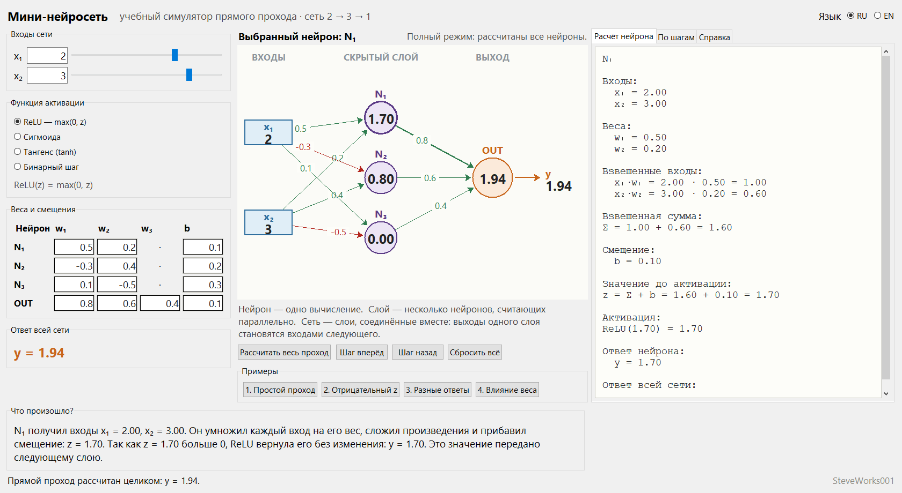
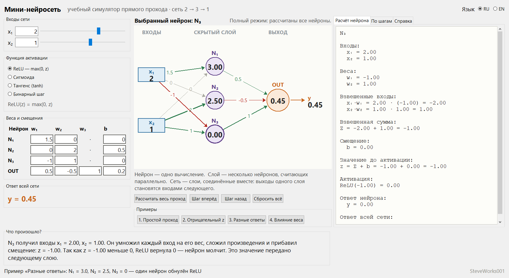
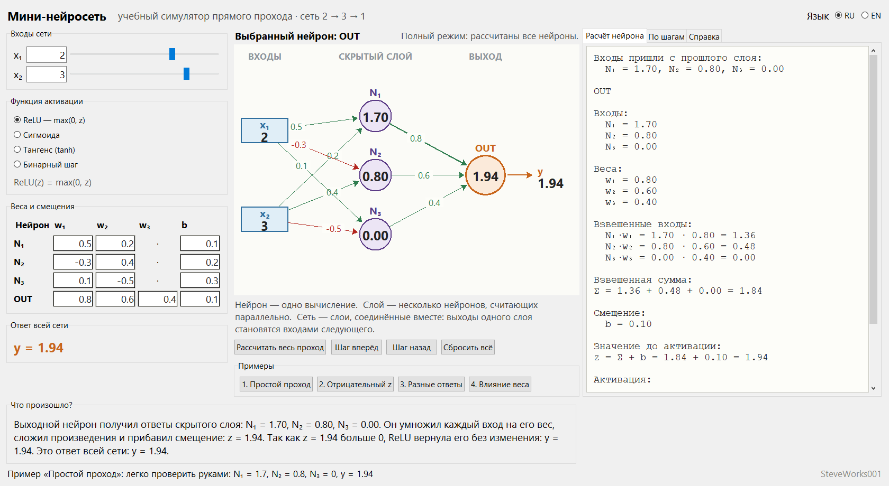
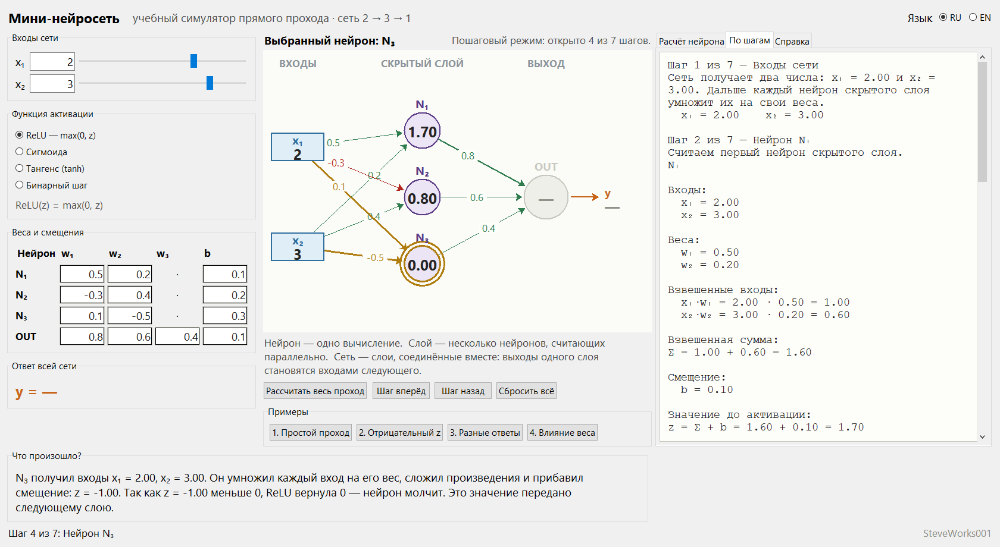

# Мини-нейросеть — учебный симулятор прямого прохода

**[Русский](README_RU.md) | [English](README_EN.md)**

Проект 3 из 13 серии учебных симуляторов нейронных сетей.
Однофайловое приложение на Python и Tkinter: только стандартная библиотека,
без внешних пакетов, без сети и без установки зависимостей.
**Сеть 2 → 3 → 1, в которой видно каждое число на каждом шаге**: приложение показывает
один проход данных через простую нейросеть — *forward pass*. Все веса задаёте вы, и
приложение ничему не обучается; оно существует для того, чтобы вы увидели, как из
отдельных нейронов складывается слой, а из слоёв — сеть.

---

## Назначение

Следующий шаг после проектов «Один искусственный нейрон» и «Перцептрон»: там был один
нейрон, здесь их уже четыре, соединённых в два слоя. Приложение показывает три вещи,
которые в одиночку на схеме не видны:

- нейрон считает одно число, а слой — несколько чисел параллельно;
- выходы одного слоя буквально становятся входами следующего;
- изменение одного веса в любом месте меняет ответ всей сети, и видно, на каком именно
  нейроне это начинается.

### Чего в этом проекте нет

- нет обучения, обратного распространения ошибки и градиентного спуска;
- нет функции потерь, датасетов, эпох, метрик и предсказаний по данным;
- нет автоматического подбора весов — только ручные значения и готовые примеры;
- нет произвольной архитектуры: сеть всегда `2 → 3 → 1`;
- нет сохранения проекта, файлов, базы данных и сети.

Приложение **не обучает нейросеть**. Оно объясняет, что происходит за один проход
вперёд, когда веса уже известны.

---

## Учебные цели

- Понять, что каждый нейрон считает одно число: `z = Σ(xᵢ·wᵢ) + b`, затем `y = f(z)`.
- Понять, что слой — это несколько нейронов, которые считают параллельно и не видят
  друг друга.
- Понять передачу между слоями: три числа скрытого слоя становятся тремя входами
  выходного нейрона.
- Запомнить, что смещение `b` прибавляется всегда, даже когда все входы обнулены.
- Понять, что «мёртвый» на ReLU нейрон никуда не исчезает: он участвует в расчёте
  следующего слоя и просто даёт вклад `0`.
- Увидеть, как смена одного веса меняет ответ всей сети, и найти это по шагам.
- Научиться отличать `z` нейрона от его ответа `y` на каждом из семи шагов прохода.

---

## Математика и архитектура

```text
2 входа      3 нейрона        1 нейрон
x₁ ──┐     ┌──► N₁ ──┐
     ├─────┼──► N₂ ──┼──► OUT ──► y
x₂ ──┘     └──► N₃ ──┘
```

Связи полные: каждый вход идёт к каждому нейрону скрытого слоя (2 × 3 = 6 весов), каждый
нейрон скрытого слоя идёт в выходной нейрон (3 веса), плюс четыре смещения. Итого
**9 весов + 4 смещения + 2 входа = 15 чисел**, и все они редактируются.

Как считается один нейрон:

```text
z = x₁·w₁ + x₂·w₂ + ... + xₙ·wₙ + b
y = activation(z)
```

Для выбранного нейрона приложение печатает всю цепочку подстановок, а не только ответ:

```text
N₁

Входы:
  x₁ = 2.00
  x₂ = 3.00

Веса:
  w₁ = 0.50
  w₂ = 0.20

Взвешенные входы:
  x₁·w₁ = 2.00 · 0.50 = 1.00
  x₂·w₂ = 3.00 · 0.20 = 0.60

Взвешенная сумма:
Σ = 1.00 + 0.60 = 1.60

Смещение:
  b = 0.10

Значение до активации:
z = Σ + b = 1.60 + 0.10 = 1.70

Активация:
ReLU(1.70) = 1.70

Ответ нейрона:
  y = 1.70
```

Во всех формулах числа печатаются с двумя десятичными знаками — как в учебном разборе на
доске.

### Функции активации

Переключаются в левой панели, формула показана под переключателем.

| Название | Формула | Диапазон ответа |
|---|---|---|
| ReLU (по умолчанию) | `ReLU(z) = max(0, z)` | от 0 до +∞ |
| Сигмоида | `σ(z) = 1 / (1 + e⁻ᶻ)` | от 0 до 1 |
| Тангенс | `tanh(z)` | от −1 до 1 |
| Бинарный шаг | `шаг(z) = 1 при z ≥ 0, иначе 0` | 0 или 1 |

ReLU выбрана по умолчанию, потому что её проще всего нарисовать и проверить руками.
Каталога активаций здесь нет намеренно: важнее арифметика, чем список функций.

### Прямой проход целиком (значения по умолчанию)

Скрытый слой:

```text
N₁: z = 2·0.5 + 3·0.2 + 0.1 = 1.70    → ReLU(1.70) = 1.70
N₂: z = 2·(-0.3) + 3·0.4 + 0.2 = 0.80  → ReLU(0.80) = 0.80
N₃: z = 2·0.1 + 3·(-0.5) + 0.3 = -1.00 → ReLU(-1.00) = 0.00
```

Передача на следующий слой: выходы `N₁`, `N₂`, `N₃` становятся входами `OUT`.

Выходной нейрон:

```text
OUT: z = 1.7·0.8 + 0.8·0.6 + 0·0.4 + 0.1
       = 1.36 + 0.48 + 0.00 + 0.10 = 1.94
ReLU(1.94) = 1.94

y = 1.94
```

Обратите внимание на `N₃`: его ответ `0` не «пропал» — он умножается на `w₃ = 0.4` и даёт
`0.00` в сумме выходного нейрона. Так и должно быть.

### Семь шагов прохода

| Шаг | Название | Что видно |
| --- | --- | --- |
| 1 | Входы сети | `x₁` и `x₂` |
| 2 | Нейрон N₁ | полный расчёт N₁ |
| 3 | Нейрон N₂ | полный расчёт N₂ |
| 4 | Нейрон N₃ | полный расчёт N₃ |
| 5 | Передача на следующий слой | выходы N₁, N₂, N₃ становятся входами OUT |
| 6 | Выходной нейрон | полный расчёт OUT |
| 7 | Итог | `y` |

---

## Интерфейс и как пользоваться

- **Левая панель** — входы (текстовое поле + ползунок в диапазоне −5…5), переключатель
  функции активации с формулой, таблица весов из 4 строк (`N₁`, `N₂`, `N₃`, `OUT`) и
  4 столбцов (`w₁`, `w₂`, `w₃`, `b`), а крупным шрифтом — ответ всей сети. У нейронов
  скрытого слоя в ячейке `w₃` стоит прочерк `·`: третьего входа к ним не идёт, поэтому
  поля для него нет.
- **Схема сети (центр)** — входы показаны синими прямоугольниками, нейроны скрытого слоя
  фиолетовыми кругами, выходной нейрон оранжевым; внутри каждого нейрона его ответ. Числа
  на проводах — веса: зелёный положительный, красный отрицательный, серый нулевой, а чем
  толще линия, тем больше модуль веса. Клик по нейрону открывает его расчёт.
- **Правые вкладки** — «Расчёт нейрона» (полная арифметика выбранного нейрона), «По шагам»
  (накопительный журнал от шага 1 до открытого), «Справка» (10 разделов теории).
- **Блок «Что произошло?»** — четыре коротких предложения человеческим языком про текущий
  нейрон: что он получил, что сделал, почему ответ такой, что будет дальше.
- **Кнопки** — «Рассчитать весь проход», «Шаг вперёд» и «Шаг назад» (по одному шагу за
  нажатие), «Сбросить всё» для возврата к значениям по умолчанию и четыре кнопки примеров.
- **Пошаговый режим**: пока нейрон не дошёл до своей очереди, его ответ на схеме показан
  прочерком, а на вкладке расчёта — надпись, сколько раз ещё нажать «Шаг вперёд». Если
  поменять любое число в середине прохода, сеть пересчитается целиком.
- **Пересчёт живой**: изменение любого числа сразу обновляет схему, все ответы и
  пояснения. Поведение при нечисловом вводе разное в двух местах: ячейка таблицы весов
  подсветится, и приложение напишет, какое именно поле виновато, а в полях входов `x₁`
  и `x₂` нечисловой текст молча игнорируется, пока поле снова не станет числом. В обоих
  случаях расчёт остаётся по последним правильным значениям. Запятая как десятичный
  разделитель понимается (`0,5`).

Интерфейс доступен на русском и английском и переключается на ходу, без перезапуска;
русский установлен по умолчанию. Математические обозначения (`x₁`, `w₁`, `Σ`, `z`, `y`,
`N₁`, `OUT`) и введённые числа при смене языка остаются на месте.

---

## Скриншоты

Снимки сделаны из реально запущенного приложения (окно 1680 × 920 пикселей, русский
интерфейс).

**Главное окно** — значения по умолчанию, полный прямой проход, вкладка «Расчёт нейрона»
для `N₁`, ответ сети `y = 1.94`:



**Пример 3 «Разные ответы»** — три нейрона скрытого слоя дают 3.00, 2.50 и 0.00; выбран
`N₃`, чей отрицательный `z` ReLU обнулила:



**Расчёт выходного нейрона** — строка «Входы пришли с прошлого слоя» показывает, что
три ответа скрытого слоя стали входами `OUT`:



**Пошаговый режим, шаг 4 из 7** — янтарным подсвечен нейрон, который считается сейчас,
`OUT` и `y` ещё не вычислены (прочерки), справа накопительный журнал шагов:



---

## Примеры

Каждый пример загружает и числа, и функцию активации; объяснение появляется в строке
состояния и в блоке «Что произошло?».

### Пример 1 — простой проход

```text
x₁ = 2, x₂ = 3, ReLU
N₁: z = 1.70 → y = 1.70
N₂: z = 0.80 → y = 0.80
N₃: z = -1.00 → y = 0.00
OUT: z = 1.94 → y = 1.94
```

Всё считается вручную за минуту: произведения — круглые числа, итог виден сразу.

### Пример 2 — отрицательный z на ReLU

```text
x₁ = 1, x₂ = 2, ReLU
N₁: z = -2·1 + (-1)·2 + 0.5 = -3.50 → y = 0.00
N₂: z =  1·1 + (-1)·2 + 0.2 = -0.80 → y = 0.00
N₃: z =  2·1 + (-1)·2 - 0.1 = -0.10 → y = 0.00
OUT: z = 0·1 + 0·1 + 0·1 + 0.3 = 0.30 → y = 0.30
```

Все три нейрона молчат, а сеть отвечает: выходной нейрон получает только своё смещение.
Урок: `b` — не «запасной вход», он прибавляется всегда. Если переключить этот пример на
сигмоиду, скрытый слой перестанет выдавать нули: `σ(-3.50) ≈ 0.03`, `σ(-0.80) ≈ 0.31`,
`σ(-0.10) ≈ 0.48`, и ответ сети станет `y ≈ 0.75`.

### Пример 3 — разные ответы нейронов

```text
x₁ = 2, x₂ = 1, ReLU
N₁: z = 1.5·2 + 0·1 + 0   = 3.00 → y = 3.00
N₂: z = 0·2 + 2·1 + 0.5   = 2.50 → y = 2.50
N₃: z = -1·2 + 1·1 + 0    = -1.00 → y = 0.00
OUT: z = 0.5·3 + (-0.5)·2.5 + 1·0 + 0.2 = 0.45 → y = 0.45
```

Три нейрона одного слоя дают три разных числа — слой это параллельные вычисления, а не
одно на всех. У `N₃` вес при `x₁` больше по модулю, чем вклад `x₂`, поэтому сумма уходит
в минус и ReLU обнуляет ответ.

### Пример 4 — влияние одного веса

```text
Тот же набор, что в примере 1, но у OUT: w₁ = 0.8 → 0.2
N₁ = 1.70, N₂ = 0.80, N₃ = 0.00   (скрытый слой не изменился)
OUT: z = 1.7·0.2 + 0.8·0.6 + 0·0.4 + 0.1 = 0.92 → y = 0.92
```

Ответ сети меняется с `1.94` на `0.92` из-за одного веса. Скрытый слой об этом не
подозревает: он считает то же самое, потому что не видит следующего слоя.

---

## Учебные опыты

Опыты сделаны на значениях по умолчанию (`x₁ = 2`, `x₂ = 3`, ReLU, скрытый слой даёт
`1.70`, `0.80`, `0`, ответ сети `1.94`), поэтому числа в них совпадают с тем, что вы
увидите на экране. Считайте предсказания сами, а потом проверяйте их в приложении.

**1. Один вес скрытого слоя.** Измените `w₁` нейрона `N₁` с `0.5` на `2`.
Наблюдайте: на вкладке «Расчёт нейрона» `z` у `N₁` становится `4.7`, а ответ всей сети —
`4.34`, то есть меняется не только `N₁`, но и `OUT`. Кликните по `OUT` и найдите, откуда
в его сумме взялось новое слагаемое. О чём подумать: почему ответ сети изменился сильнее,
чем ответ одного нейрона, — и во сколько раз.

**2. Отрицательный вес молчит.** Уменьшите `w₂` нейрона `N₁` с `0.2` до `-0.8`, тогда
`z = 2·0.5 + 3·(-0.8) + 0.1 = -1.3`.
Наблюдайте: на ReLU ответ `N₁` становится ровно `0`, а сеть всё равно выдаёт число
(слагаемое `N₁` исчезает из суммы `OUT`, остаются `N₂` и смещение). Переключите теперь
активацию на Sigmoid, не меняя чисел, и посмотрите, что `N₁` перестаёт быть нулём.
О чём подумать: чем «ноль» ReLU отличается от «маленького, но положительного» ответа
сигмоиды для следующего слоя.

**3. Весь скрытый слой обнулён.** Загрузите пример 2 кнопками примеров.
Наблюдайте: `N₁`, `N₂` и `N₃` дают `0`, а сеть отвечает `0.3` — это смещение выходного
нейрона. Пройдите «Шаг вперёд» и посмотрите, на каком шаге нули скрытого слоя перестают
быть видны как результат и начинают выглядеть как «ничего не считается».
О чём подумать: если все нейроны предыдущего слоя молчат, какая часть сети ещё может
что-то сказать — и достаточно ли этого для реального предсказания.

**4. Слой против одного нейрона.** На значениях по умолчанию кликните `N₃`: его `z`
равен `-1.0`, ответ `0`. Теперь сравните: почему «ноль» одного нейрона почти не ломает
сеть, а «ноль» всех трёх (пример 2) ломает.
Наблюдайте: вклад `N₃` в сумму `OUT` идёт через `w₃ = 0.4`, поэтому при `y₃ = 0` это
просто `0 · 0.4`.
О чём подумать: зачем в слое больше одного нейрона — и почему на этом же механизме
держится идея «мёртвых» нейронов ReLU.

---

## Установка и запуск

Приложение — один файл; сборки и установки зависимостей не требуется.

```bash
python mini_neural_network.py
```

На macOS и Linux, если нужно: `python3 mini_neural_network.py`.

Быстрый старт: нажмите **«Рассчитать весь проход»** — сеть со значениями по умолчанию даст
`N₁ = 1.70`, `N₂ = 0.80`, `N₃ = 0.00` и `y = 1.94`. Потом нажмите **«Шаг вперёд»** семь раз,
чтобы пройти весь расчёт по порядку, и кликните любой нейрон на схеме, чтобы увидеть его
арифметику целиком.

---

## Требования

- Python 3.8 или новее.
- Tkinter — входит в официальные сборки Python для Windows и macOS; в некоторых
  дистрибутивах Linux ставится отдельно как пакет `python3-tk`.
- Только стандартная библиотека: `math`, `textwrap`, `tkinter`, `tkinter.ttk`,
  `tkinter.font`.
- Не используются: NumPy, pandas, SciPy, matplotlib, PyTorch, TensorFlow и любые пакеты
  из `pip`.
- Сетевое соединение для работы приложения не требуется.

Окно построено вокруг трёх панелей, стоящих рядом, поэтому его минимальные размеры —
1640 × 880 пикселей: на более узком или более низком экране окно целиком не
помещается. При запуске оно занимает 1680 × 920 пикселей, а если дисплей меньше, то
настолько, насколько позволяет экран.

---

## Ограничения

- Это **не** фреймворк машинного обучения и **не** тренажёр предсказаний.
- Нет обучения, обратного распространения ошибки и градиентного спуска.
- Нет функции потерь, датасетов, эпох и метрик.
- Архитектура фиксирована — всегда `2 → 3 → 1`; добавить слой или изменить число нейронов
  можно только правкой кода.
- Функций активации четыре, и они применяются ко всем нейронам сети сразу: выбрать функцию
  для отдельного нейрона нельзя.
- Скрытый слой не видит следующего слоя, поэтому «сюрприз» от изменения веса выходного
  нейрона — это свойство модели, а не ошибка отображения.
- Нет сохранения и загрузки: состояние не пишется в файлы и не экспортируется.
- Только графический интерфейс: нет консольного режима, API или пакетного запуска.
- Два языка интерфейса: русский и английский.

---

## Учебная оговорка

Симулятор предназначен для понимания прямого прохода, а не для получения предсказаний.
Отдельные соглашения выбраны ради наглядности и могут отличаться от соглашений, принятых в
конкретной библиотеке машинного обучения: например, бинарный шаг здесь относит `z = 0` к
ответу `1`, а числа в формулах печатаются с двумя десятичными знаками. Перед использованием
в реальной модели сверяйтесь с определениями вашей библиотеки.

---

## Что нужно знать заранее

**Строго необходимо:** Python 3 с Tkinter; запуск одного файла из командной строки.
Зависимостей, сети и внешних файлов нет.

**Математика:** умножение и сложение чисел, отрицательные числа, чтение формул с
индексами (`w₁`, `N₂`, `Σ`). Производные и градиенты не нужны: обратного хода здесь нет.

**Полезно, но не обязательно:** проект 1 «Один искусственный нейрон» — тот же расчёт
`z = Σ + b`, `y = f(z)` в одном нейроне. Без него всё объясняется заново, просто чуть
длиннее.

О версии Python: в разделе «Требования» заявлен Python 3.8 или новее — это объявленная
совместимость, а не проверенная гарантия: приложение версию не проверяет. Релизная копия
запускалась на CPython 3.12.10 под Windows 10; версии ниже 3.8 не проверялись.

---

## Место в серии

Проект 3 из 13. Порядок не строгий — каждый проект самодостаточен.

| Проект | Связь по содержанию |
|---|---|
| 1 — Один искусственный нейрон | один нейрон по частям; здесь тот же расчёт повторяется
четыре раза в двух слоях |
| 2 — Перцептрон | нейрон как классификатор с порогом; здесь ответа «класс» нет, есть
число |
| 7 — Activation Functions | объясняет, почему смена ReLU на Sigmoid меняет всё, что вы
видите в опытах выше |
| 5, 6 — Backpropagation, Neural Network Training | там веса подбираются автоматически;
здесь все числа задаёте вы, и обучение отсутствует намеренно |

Прямой проход из этого проекта — то же самое вычисление, которое в проектах 5 и 6
разворачивают назад, чтобы посчитать градиенты.

---

## Разработчик

**Разработчик: SteveWorks001**

---

## Лицензия

Проект распространяется под лицензией [MIT License](LICENSE).
